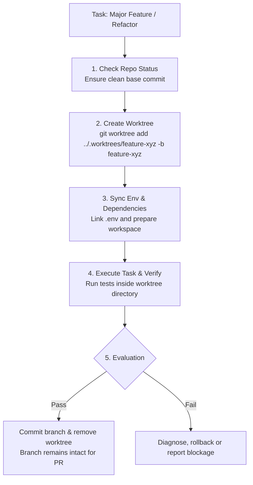

# Git Worktree Sandboxing & Isolation

## Overview
When agents perform significant refactorings, test suite runs, or multi-file migrations directly inside the developer's primary working tree, they risk:
1. Overwriting uncommitted local changes.
2. Breaking the developer's active editor environment mid-flow.
3. Leaving dirty git state if a task is abandoned or errors out.

This skill provides an automated, isolated **Git Worktree Sandbox** workflow that allows the agent to build, test, and verify features in an independent directory while the developer continues uninterrupted in the main branch.

---

## 1. The Worktree Lifecycle Protocol



---

## 2. Step-by-Step Instructions

### Step 1: Initialize the Worktree
From the repository root, create an isolated worktree under a hidden sibling folder (e.g., `../.worktrees/<branch>`):

```bash
BRANCH_NAME="feat/user-auth-revamp"
WORKTREE_PATH="../.worktrees/${BRANCH_NAME//\//-}"

# Create the worktree on a new branch derived from main/current HEAD
git worktree add -b "$BRANCH_NAME" "$WORKTREE_PATH" HEAD
```

### Step 2: Environment Hydration
Copy or symlink environment files that are ignored by git (e.g., `.env`, `.env.local`):

```bash
if [ -f .env.local ]; then
  cp .env.local "$WORKTREE_PATH/.env.local"
elif [ -f .env ]; then
  cp .env "$WORKTREE_PATH/.env"
fi
```

### Step 3: Execute Agent Tasks Inside the Worktree
All tool calls, file writes, and test commands for this task must use `Cwd: "$WORKTREE_PATH"` (the worktree root, NOT your primary repository root).

```bash
# Example execution inside the worktree
cd "$WORKTREE_PATH"
npm test
```

### Step 4: Verification & Clean Commit
Once tests and linter checks pass:
1. Stage and commit the changes inside the worktree using conventional commits:
   ```bash
   git add .
   git commit -m "feat(auth): implement token refresh with rate limiting"
   ```
2. Push the branch to the remote if requested.

### Step 5: Teardown the Worktree
Once work is committed:
```bash
# Return to the primary repo and remove the temporary directory
git worktree remove "$WORKTREE_PATH"
```
*Note: Removing the worktree deletes the temporary directory, but the git branch and all commits remain safely preserved in the repository history.*

---

## 3. Safety Rules
* **Never delete a worktree with uncommitted changes without explicit user consent.** Use `git status` inside the worktree before teardown.
* **Never alter the primary repository's git stash or working tree.** The primary workspace must remain untouched throughout the agent's operation.
