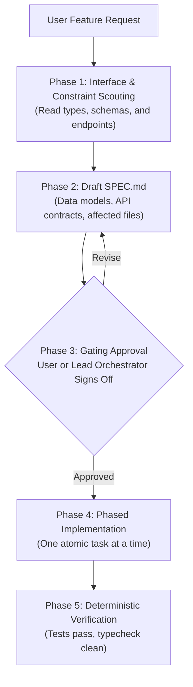

# Spec-Driven Feature Development

## Overview
This skill enforces a **Plan-Before-Code Gating Protocol**. Autonomous coding agents often fail by leaping directly into file edits, leading to context drift, hallucinated APIs, and wasted tokens on trial-and-error debugging.

When this skill activates, **no application code may be modified** until a formal specification (`SPEC.md`) is drafted, verified against repository constraints, and approved.

---

## 1. The 4-Phase Protocol

---

## 2. Phase 1: Context & Constraint Scouting

Before drafting the specification:
1. Identify existing conventions, data models, and API utilities in the project.
2. Locate type definitions or schema files (e.g., `schema.prisma`, `drizzle/schema.ts`, Zod schemas, OpenAPI specs).
3. Do not read entire files unless necessary; inspect exports, interface headers, and types.

---

## 3. Phase 2: Draft `SPEC.md`

Create a clean, focused markdown document in the repository root or `.specs/` folder titled `SPEC.md` using the standard template:

### Required Specification Sections:
1. **Feature Objective & Scope:** Clear 2-sentence problem statement and success criteria.
2. **Explicit Non-Goals:** What this feature will *not* do (prevents scope creep).
3. **Data Contracts & Signatures:** Exact TypeScript interfaces, database column types, or API schemas.
4. **Target File Matrix:**
   - Files to create.
   - Files to modify (with specific functions/lines).
   - Files strictly forbidden from being modified.
5. **Deterministic Verification Criteria:** Exact test commands, linter checks, and manual curl/browser steps to confirm functionality.

---

## 4. Phase 3: The Gating Checkpoint (MANDATORY)

Once `SPEC.md` is generated:
1. Present the specification summary to the user (or parent orchestrator).
2. Explicitly ask for confirmation before writing code:
   > *"I have drafted the specification in `SPEC.md`. Please review the proposed architecture, data contracts, and affected files. Shall I proceed with implementation?"*
3. **HARD STOP:** Wait for approval or feedback. Do not touch source files until given the green light.

---

## 5. Phase 4: Phased Execution

Upon approval:
1. Implement the feature in discrete, atomic milestones (e.g., Schema $\to$ Core Logic $\to$ API Handlers $\to$ UI/Integration).
2. Mark off progress checkboxes in `SPEC.md` as milestones complete.
3. Keep git commits scoped to individual milestones.

---

## 6. Phase 5: Verification & Archive

1. Run the deterministic test suite specified in Phase 2.
2. Verify all type-checks and linters pass cleanly.
3. Move `SPEC.md` to `.specs/completed/YYYY-MM-DD-<feature-name>.md` or archive it for historical reference.
